<!--
  Profile dashboard for github.com/Pranav-0710
  - output branch ........... panels rebuilt daily by .github/workflows/dashboard.yml (script: .github/scripts/dashboard.py)
  - assets/ ................. static hero panel, prompt lines and link buttons
  - .github/DASHBOARD.md .... how it works, setup, fallbacks, checklist
-->

<picture>
  <source media="(max-width: 600px)" srcset="https://raw.githubusercontent.com/Pranav-0710/Pranav-0710/main/assets/hero-mobile.svg" />
  
</picture>

<picture>
  <source media="(max-width: 600px)" srcset="https://raw.githubusercontent.com/Pranav-0710/Pranav-0710/output/whoami-mobile.svg" />
  
</picture>

<picture>
  <source media="(max-width: 600px)" srcset="https://raw.githubusercontent.com/Pranav-0710/Pranav-0710/main/assets/prompt-now-mobile.svg" />
  
</picture>

<table>
<tr>
<td width="33%" valign="top">

**building** 
[Krama](https://github.com/Pranav-0710/Krama): a small coding model that plans first, then codes, then explains why. LoRA fine-tune of Qwen2.5-Coder-1.5B for Python and FastAPI, with the test tasks and scoring rules fixed before training.

</td>
<td width="33%" valign="top">

**in development** 
[dhwani-desk](https://github.com/Pranav-0710/dhwani-desk): a Kannada-first voice helpline for civic complaints, for the Great Indian AI Internship Challenge (Gnani AI).

</td>
<td width="33%" valign="top">

**open to** 
Internships and collaborations in software engineering, ML / AI engineering and full-stack. [Email](mailto:pranavkanth07@gmail.com) or [LinkedIn](https://www.linkedin.com/in/jey-pranav-783761278/).

</td>
</tr>
</table>

<picture>
  <source media="(max-width: 600px)" srcset="https://raw.githubusercontent.com/Pranav-0710/Pranav-0710/main/assets/prompt-projects-mobile.svg" />
  
</picture>

<table>
<tr>
<td width="50%" valign="top">

#### [reliefroute](https://github.com/Pranav-0710/reliefroute)
Agent Wars · GDG DevFest 2026

Flood-relief logistics agent for Chennai. It reads field reports as text, photos or voice notes in English, Tamil, Tanglish or Hindi, plans truck routes on real road distances around reported floods, replans when a road is blocked mid-delivery, and learns from each run. Also exposed as an MCP server.

`Python` `FastAPI` `Gemini` `PyTorch` `OpenEnv` `MCP` `Docker`

[live app](https://reliefroute.vercel.app)

</td>
<td width="50%" valign="top">

#### [dhwani-desk](https://github.com/Pranav-0710/dhwani-desk)
`status: in development` · Great Indian AI Internship Challenge (Gnani AI)

Kannada-first voice helpline for civic complaints. Gnani Prisma transcribes the caller, the Laya engine decides department, ward, urgency and when a human must step in (locally, no LLM in the call path), and Gnani Timbre speaks the reply. A supervisor console lets an officer take over a call.

`Python` `FastAPI` `React` `TypeScript` `Vite` `Laya`

my part: voice pipeline and serving

</td>
</tr>
<tr>
<td width="50%" valign="top">

#### [DataEngEnv · PipelineOps Arena](https://github.com/Pranav-0710/DataEngEnv)
Meta AI × Hugging Face OpenEnv Hackathon 2026

A four-stage OpenEnv environment where an LLM agent repairs a broken ML pipeline: schema drift, unscaled features, data leakage, then a fairness gate. Rewards come from actually running the fixed script, not from an LLM judge.

`Python` `FastAPI` `Docker` `OpenEnv` `Unsloth` `LoRA` `GRPO`

[live Space](https://huggingface.co/spaces/CoBeDigger/DataEngEnv) · [trained adapter](https://huggingface.co/CoBeDigger/pipelineops-arena-llama3-grpo)

</td>
<td width="50%" valign="top">

#### [signal-hunters](https://github.com/Pranav-0710/signal-hunters)
Hack4Hack ML Challenge 2026, Round 2 · Team Cyclops

Classifies SETI ON/OFF radio-telescope cadences into 9 classes when the training data comes from one telescope and the test set from another. A stack of 11 models (LightGBM on hand-built features, CNNs and EfficientNets) took public macro-F1 from 0.7884 to 0.9088.

`Python` `LightGBM` `PyTorch` `timm` `scikit-learn`

Round 1: [planet-hunters](https://github.com/Pranav-0710/planet-hunters) · 0.7564 public macro-F1 on TESS-like light curves

</td>
</tr>
<tr>
<td width="50%" valign="top">

#### [Terrain](https://github.com/Pranav-0710/Terrain)
built for an OpenAI hackathon

News-intelligence platform that maps live events onto a 3D WebGL globe and compares how outlets around the world frame the same story, with LLM-based consensus and contradiction analysis over GDELT and RSS feeds.

`Next.js` `React` `Three.js` `FastAPI` `Supabase` `PostGIS`

[live demo](https://terrain-green.vercel.app)

</td>
<td width="50%" valign="top">

#### [neuroselect](https://github.com/Pranav-0710/neuroselect)
`status: baseline stage` · research codebase

Reproducible groundwork for non-invasive brain-to-text decoding: a character-level CTC baseline on public SpanishBCBL MEG recordings, with documented label-mapping, alignment and CTC-geometry audits. No benchmark claimed yet.

`Python` `PyTorch` `MNE` `NumPy` `SciPy` `pytest`

</td>
</tr>
</table>

<b>more in ~/projects</b>

 

| repo | what it is | stack |
| --- | --- | --- |
| [PRO-TECHT](https://github.com/Pranav-0710/PRO-TECHT) | Service-center portal: job tracking, warranties, customer chat, reports, role-based views | React · TypeScript · shadcn/ui · Supabase |
| [AI_ENGG](https://github.com/Pranav-0710/AI_ENGG) | AI engineering roadmap (15 projects, 5 phases) with Claude Code hooks that block AI edits to core logic | Bash · Python |
| [ChurnPrediction-](https://github.com/Pranav-0710/ChurnPrediction-) | Telco churn classifier with a Streamlit app and a Power BI report | scikit-learn · Streamlit · Power BI |
| [SalesPrediction](https://github.com/Pranav-0710/SalesPrediction) | 24-month retail sales forecast with confidence intervals | pandas · Prophet · Power BI |
| [f1-MODEL](https://github.com/Pranav-0710/f1-MODEL) | My first ML project: Formula 1 prediction notebook | pandas · scikit-learn |

<picture>
  <source media="(max-width: 600px)" srcset="https://raw.githubusercontent.com/Pranav-0710/Pranav-0710/output/contributions-mobile.svg" />
  
</picture>

<picture>
  <source media="(max-width: 600px)" srcset="https://raw.githubusercontent.com/Pranav-0710/Pranav-0710/output/languages-mobile.svg" />
  
</picture>

<picture>
  <source media="(max-width: 600px)" srcset="https://raw.githubusercontent.com/Pranav-0710/Pranav-0710/main/assets/prompt-stack-mobile.svg" />
  
</picture>

| layer | tools |
| --- | --- |
| `languages` |      |
| `ml · data` |      also: LightGBM · timm · Prophet · MNE · Matplotlib · Seaborn |
| `llm · agents` |   also: Unsloth · LoRA / GRPO fine-tuning · OpenEnv · MCP · Gemini, Groq and OpenAI APIs |
| `backend` |    also: Pydantic · PostGIS · Uvicorn |
| `frontend` |      also: shadcn/ui · Framer Motion |
| `ship · test` |     also: Vitest · Hugging Face Spaces · Render · Git |
| `analytics` |  also: Power BI |

<picture>
  <source media="(max-width: 600px)" srcset="https://raw.githubusercontent.com/Pranav-0710/Pranav-0710/main/assets/prompt-links-mobile.svg" />
  
</picture>

  
  &nbsp;
  

linkedin.com/in/jey-pranav-783761278 · pranavkanth07@gmail.com

<picture>
  <source media="(max-width: 600px)" srcset="https://raw.githubusercontent.com/Pranav-0710/Pranav-0710/main/assets/footer-mobile.svg" />
  
</picture>
