<!--
  Profile dashboard for github.com/Pranav-0710
  - output branch ........... data panels rebuilt daily by .github/workflows/dashboard.yml (script: .github/scripts/dashboard.py)
  - assets/ ................. static hero, project panels, prompt lines and buttons (script: .github/scripts/static_assets.py)
  - .github/DASHBOARD.md .... how it works, setup, fallbacks, checklist
-->

<picture>
  <source media="(max-width: 600px)" srcset="https://raw.githubusercontent.com/Pranav-0710/Pranav-0710/main/assets/hero-mobile.svg" />
  
</picture>

<picture>
  <source media="(max-width: 600px)" srcset="https://raw.githubusercontent.com/Pranav-0710/Pranav-0710/output/whoami-mobile.svg" />
  
</picture>

<picture>
  <source media="(max-width: 600px)" srcset="https://raw.githubusercontent.com/Pranav-0710/Pranav-0710/output/pulse-mobile.svg" />
  
</picture>

<picture>
  <source media="(max-width: 600px)" srcset="https://raw.githubusercontent.com/Pranav-0710/Pranav-0710/output/contributions-mobile.svg" />
  
</picture>

<picture>
  <source media="(max-width: 600px)" srcset="https://raw.githubusercontent.com/Pranav-0710/Pranav-0710/main/assets/prompt-projects-mobile.svg" />
  
</picture>

<picture>
  <source media="(max-width: 600px)" srcset="https://raw.githubusercontent.com/Pranav-0710/Pranav-0710/main/assets/projects-1-mobile.svg" />
  
</picture>

<table>
<tr>
<td width="50%" align="center"><b>DataEngEnv</b> 
<a href="https://github.com/Pranav-0710/DataEngEnv">repo</a> · <a href="https://huggingface.co/spaces/CoBeDigger/DataEngEnv">live Space</a> · <a href="https://huggingface.co/CoBeDigger/pipelineops-arena-llama3-grpo">trained adapter</a></td>
<td width="50%" align="center"><b>dhwani-desk</b> 
<a href="https://github.com/Pranav-0710/dhwani-desk">repo</a> · <a href="https://lnkd.in/p/gNMNPkh4">demo video</a> · <a href="https://github.com/Pranav-0710/dhwani-desk/blob/main/docs/PITCH.md">one-page pitch</a></td>
</tr>
</table>

<picture>
  <source media="(max-width: 600px)" srcset="https://raw.githubusercontent.com/Pranav-0710/Pranav-0710/main/assets/projects-2-mobile.svg" />
  
</picture>

<table>
<tr>
<td width="50%" align="center"><b>Terrain</b> 
<a href="https://github.com/Pranav-0710/Terrain">repo</a> · <a href="https://terrain-green.vercel.app">live demo</a></td>
<td width="50%" align="center"><b>neuroselect</b> 
<a href="https://github.com/Pranav-0710/neuroselect">repo</a> · <a href="https://github.com/Pranav-0710/neuroselect#current-status">current status</a> · <a href="https://huggingface.co/datasets/bcbl190626/SpanishBCBL">SpanishBCBL dataset</a></td>
</tr>
</table>

<picture>
  <source media="(max-width: 600px)" srcset="https://raw.githubusercontent.com/Pranav-0710/Pranav-0710/output/languages-mobile.svg" />
  
</picture>

<picture>
  <source media="(max-width: 600px)" srcset="https://raw.githubusercontent.com/Pranav-0710/Pranav-0710/main/assets/prompt-more-mobile.svg" />
  
</picture>

<b>more projects</b> · reliefroute, signal-hunters, Krama and more

 

<table>
<tr>
<td width="50%" valign="top">

#### [reliefroute](https://github.com/Pranav-0710/reliefroute)
Agent Wars · GDG DevFest 2026

Flood-relief logistics agent for Chennai. It reads field reports as text, photos or voice notes in English, Tamil, Tanglish or Hindi, plans truck routes on real road distances around reported floods, replans when a road is blocked mid-delivery, and learns from each run. Also exposed as an MCP server.

[live app](https://reliefroute.vercel.app)

</td>
<td width="50%" valign="top">

#### [signal-hunters](https://github.com/Pranav-0710/signal-hunters)
Hack4Hack ML Challenge 2026, Round 2 · Team Cyclops

Classifies SETI ON/OFF radio-telescope cadences into 9 classes when the training data comes from one telescope and the test set from another. A stack of 11 models (LightGBM on hand-built features, CNNs and EfficientNets) took public macro-F1 from 0.7884 to 0.9088.

Round 1: [planet-hunters](https://github.com/Pranav-0710/planet-hunters) · 0.7564 public macro-F1 on TESS-like light curves

</td>
</tr>
</table>

| repo | what it is | stack |
| --- | --- | --- |
| [Krama](https://github.com/Pranav-0710/Krama) | In progress: a small coding model that plans first, then codes, then explains why. LoRA fine-tune of Qwen2.5-Coder-1.5B for Python and FastAPI, with the test tasks and scoring rules fixed before training | Python · FastAPI · LoRA |
| [PRO-TECHT](https://github.com/Pranav-0710/PRO-TECHT) | Service-center portal: job tracking, warranties, customer chat, reports, role-based views | React · TypeScript · shadcn/ui · Supabase |
| [AI_ENGG](https://github.com/Pranav-0710/AI_ENGG) | AI engineering roadmap (15 projects, 5 phases) with Claude Code hooks that block AI edits to core logic | Bash · Python |
| [ChurnPrediction-](https://github.com/Pranav-0710/ChurnPrediction-) | Telco churn classifier with a Streamlit app and a Power BI report | scikit-learn · Streamlit · Power BI |
| [SalesPrediction](https://github.com/Pranav-0710/SalesPrediction) | 24-month retail sales forecast with confidence intervals | pandas · Prophet · Power BI |
| [f1-MODEL](https://github.com/Pranav-0710/f1-MODEL) | My first ML project: Formula 1 prediction notebook | pandas · scikit-learn |

<picture>
  <source media="(max-width: 600px)" srcset="https://raw.githubusercontent.com/Pranav-0710/Pranav-0710/main/assets/prompt-links-mobile.svg" />
  
</picture>

  
  &nbsp;
  

linkedin.com/in/jey-pranav-783761278 · pranavkanth07@gmail.com

<picture>
  <source media="(max-width: 600px)" srcset="https://raw.githubusercontent.com/Pranav-0710/Pranav-0710/main/assets/footer-mobile.svg" />
  
</picture>
